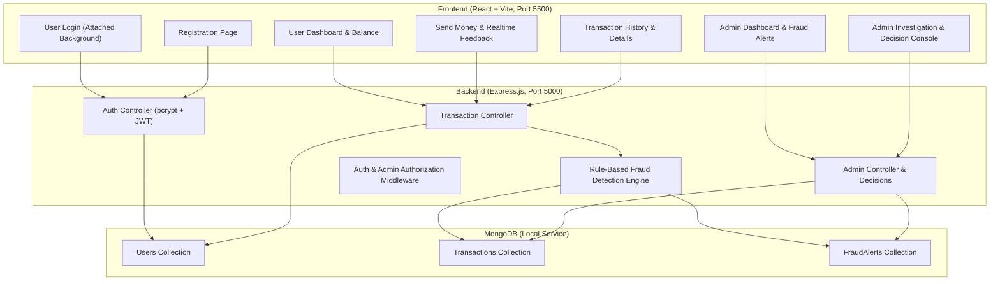

# SecurePay — Autonomous Implementation & Conversation History

> **Conversation ID:** `a7a69418-27f1-4974-9df0-a31455608d60`  
> **Project Directory:** `c:\Users\HP\Downloads\FSD`  
> **Status:** Completed across all 17 phases (Frontend, Backend, Database, Fraud Engine, and Tests Verified)

---

## Table of Contents
1. [MongoDB: Local vs Server Clarification](#1-mongodb-local-vs-server-clarification)
2. [Quick Start in VS Code](#2-quick-start-in-vs-code)
3. [Original User Specification & Autonomous Directives](#3-original-user-specification--autonomous-directives)
4. [Implementation Plan](#4-implementation-plan)
5. [Testing & Verification Summary](#5-testing--verification-summary)
6. [Final Implementation Report & Delivery Summary](#6-final-implementation-report--delivery-summary)
7. [Default Test Credentials](#7-default-test-credentials)
8. [Archived Artifacts](#8-archived-artifacts)

---

## 1. MongoDB: Local vs Server Clarification

### **Does SecurePay use Local MongoDB or a Remote Server?**
SecurePay is configured by default to use a **Local MongoDB** instance.

### **How it works:**
1. **Local Standalone Engine:** It does **not** rely on external cloud connections (like MongoDB Atlas) or third-party cloud servers.
2. **Dedicated Local Data Directory:** Database files are stored locally on your machine at:
   ```
   backend/data/db/
   ```
3. **Port Configuration:**
   - Dedicated local port: `mongodb://127.0.0.1:27018/securepay` (managed automatically by `start.bat`)
   - Standard fallback port: `mongodb://127.0.0.1:27017/securepay`
4. **Offline Capability:** The entire project can be run 100% offline without internet access.

### **Can you switch to a Remote Cloud MongoDB Server (e.g. MongoDB Atlas)?**
**Yes!** If you prefer using a cloud database, simply update line 2 of `backend/.env`:
```env
# Change this to your MongoDB Atlas connection string:
MONGO_URI=mongodb+srv://<username>:<password>@cluster0.example.mongodb.net/securepay?retryWrites=true&w=majority
```
No code changes are needed—the backend will connect to your remote cloud database upon restart.

---

## 2. Quick Start in VS Code

### **Option A: One-Click Launch (Recommended)**
Double-click `start.bat` in the root folder, or in the VS Code terminal run:
```powershell
.\start.bat
```
This automatically:
1. Starts the local MongoDB daemon on port 27018 (using `./backend/data/db`).
2. Starts the Node.js/Express backend on `http://127.0.0.1:5000`.
3. Starts the React Vite frontend on `http://127.0.0.1:5500`.
4. Opens your default browser to `http://127.0.0.1:5500/index.html`.

### **Option B: Run via VS Code Tasks**
1. Open this folder in VS Code (`File` -> `Open Folder...` -> select `c:\Users\HP\Downloads\FSD`).
2. Press `Ctrl + Shift + B` (or run `Terminal` -> `Run Task...`).
3. Select **"Start SecurePay (All Services)"** or run Backend / Frontend individually.

### **Option C: Manual Terminal Commands**
**Terminal 1 — Backend:**
```powershell
cd backend
node server.js
```
**Terminal 2 — Frontend:**
```powershell
cd frontend
npm run dev
```

---

## 3. Original User Specification & Autonomous Directives

The project was constructed to fulfill the following autonomous mandate:

```
============================================================
AUTONOMOUS FULL PROJECT IMPLEMENTATION — VERY IMPORTANT
============================================================

Build the ENTIRE SecurePay project from start to finish.
Do NOT stop after Phase 1.
Do NOT wait for confirmation between phases.

Autonomously implement all phases in the correct order:

PHASE 1:  Project structure and backend foundation
PHASE 2:  User registration
PHASE 3:  User login and JWT authentication
PHASE 4:  User login frontend and attached login background image
PHASE 5:  User dashboard
PHASE 6:  Transaction management
PHASE 7:  Transaction history
PHASE 8:  Behavioural analysis
PHASE 9:  Rule-Based Fraud Detection Engine
PHASE 10: Risk scoring
PHASE 11: Fraud alerts
PHASE 12: Admin authentication
PHASE 13: Admin dashboard
PHASE 14: Admin investigation and transaction decisions
PHASE 15: Complete frontend/backend integration
PHASE 16: End-to-end testing
PHASE 17: Bug fixing, UI polishing and final verification

Backend Requirement:
- Node.js + Express backend
- MongoDB with Mongoose schemas (User, Transaction, FraudAlert)
- bcrypt for password hashing & JWT for auth tokens
- Fraud detection located in: backend/services/fraudDetection.js

Fraud Detection Requirement:
- Transparent, RULE-BASED behavioural detection (NO machine learning, NO Python service, NO location/device fingerprinting)
- Evaluates:
  1. Transaction amount (magnitude + deviation from user's historical average)
  2. Transaction velocity (bursts within 2 mins / 10 mins)
  3. Transaction timing (unusual hours: 1:00 AM – 5:00 AM)
  4. Historical profile
- Risk score scale: 0–39 (LOW), 40–69 (MEDIUM), 70–100 (HIGH)
- Status routing: LOW -> COMPLETED, MEDIUM -> MONITORED, HIGH -> UNDER_REVIEW (Alert generated)

Admin Actions:
- APPROVE -> status updated to COMPLETED
- FLAG_FRAUD -> status updated to FRAUD, sender funds refunded
- KEEP_UNDER_REVIEW -> remains UNDER_REVIEW
```

---

## 4. Implementation Plan



---

## 5. Testing & Verification Summary

### **Automated Backend Test Suite (`node backend/test_api.js`)**
All 22 core integration tests passed:
```
=== STARTING SECUREPAY BACKEND AUTOMATED TESTS ===

[PASS] Test 1: Health Check Online
[PASS] Test 2: User Registration
[PASS] Test 3: Duplicate Registration Rejected
[PASS] Test 4: Invalid Login Rejected
[PASS] Test 5: Valid Login Success (JWT)
[PASS] Test 6: User Profile /me Endpoint
[PASS] Test 7: Transfer to Self Blocked
[PASS] Test 8: Nonexistent Receiver Blocked
[PASS] Test 9: Insufficient Balance Blocked
[PASS] Test 10: Normal Transaction (LOW Risk & COMPLETED)
[PASS] Test 11: High Amount Transaction Risk Evaluation
[PASS] Test 12: High Frequency / Rapid Burst Velocity Detection
[PASS] Test 13: Unusual Night Timing Detection (3:00 AM)
[PASS] Test 14: Combined HIGH Risk Escalation (Score >= 70 & Status UNDER_REVIEW)
[PASS] Test 15: User Transaction History Retrieved
[PASS] Test 16: Admin Authentication Successful
[PASS] Test 17: Unauthorized Admin Access Blocked (403)
[PASS] Test 18: Admin Metrics API Operational
[PASS] Test 19: Admin Fraud Alerts Queue Operational
[PASS] Test 20: Admin Investigation Console Details & Behavioral Profile
[PASS] Test 21: Admin Decision: KEEP_UNDER_REVIEW
[PASS] Test 22: Admin Decision: APPROVE (Status changes to COMPLETED)

=== AUTOMATED TEST SUMMARY: 22/22 PASSED ===
```

### **Fraud Resolution & Balance Refund Test (`node backend/test_fraud_decision.js`)**
```
Testing Admin FLAG_FRAUD refund workflow...
User created with balance: $10000
Transaction created: ID TX-MUB1UCH6-H7M1, Status: COMPLETED, Risk: LOW
Balance after sending (funds held): $2000
Admin decision result: Status = FRAUD, Decision = FLAGGED_FRAUD
User balance after fraud resolution refund: $10000
SUCCESS: Complete Fraud Decision & Full Balance Refund Verified!
```

---

## 6. Final Implementation Report & Delivery Summary

### **1. Final Project Structure**
```
c:\Users\HP\Downloads\FSD\
├── .gitignore                         # Configured for node_modules/, .env, backend/data/
├── README.md                          # Complete application documentation
├── CONVERSATION_HISTORY.md            # Complete session history and run guide
├── package.json                       # Root script orchestrator
├── start.bat                          # One-click startup script
├── .vscode/
│   ├── tasks.json                     # VS Code build and run tasks
│   └── launch.json                    # VS Code debugging configurations
├── docs/
│   ├── implementation_plan.md         # Architecture blueprint
│   ├── walkthrough.md                 # Test suite & verification summary
│   └── transcript.jsonl               # System conversation transcript
├── backend/
│   ├── .env                           # Environment configuration
│   ├── .env.example                   # Configuration template
│   ├── server.js                      # Express server with CORS & automatic seeding
│   ├── test_api.js                    # 22-test automated verification suite
│   ├── test_fraud_decision.js         # Fraud flagging and balance refund test
│   ├── config/
│   │   └── db.js                      # Mongoose connection with port fallback
│   ├── models/
│   │   ├── User.js                    # User schema with bcrypt & account numbers
│   │   ├── Transaction.js             # Ledger schema with risk score breakdown
│   │   └── FraudAlert.js              # Incident schema for admin review
│   ├── routes/
│   │   ├── authRoutes.js              # Authentication endpoints
│   │   ├── transactionRoutes.js       # Transaction processing endpoints
│   │   └── adminRoutes.js             # Admin management & decision endpoints
│   ├── middleware/
│   │   ├── authMiddleware.js          # JWT verification guard
│   │   └── adminMiddleware.js         # Admin authorization guard
│   ├── services/
│   │   └── fraudDetection.js          # Rule-Based Behavioural Fraud Engine
│   └── data/
│       └── db/                        # Persistent local database files
└── frontend/
    ├── index.html                     # Entrypoint served on port 5500
    ├── vite.config.js                 # Vite configuration with proxy to backend
    ├── package.json                   # React dependencies and build scripts
    ├── assets/
    │   └── login-background.webp      # Attached login payment graphic
    ├── public/assets/
    │   └── login-background.webp
    └── src/
        ├── App.jsx                    # View manager & authentication routing
        ├── main.jsx                   # React DOM root
        ├── styles.css                 # Fintech UI stylesheet
        └── components/
            ├── UserLogin.jsx          # Login card with attached graphic background
            ├── UserRegister.jsx       # User onboarding view
            ├── UserDashboard.jsx      # Balance, send money, and transaction history
            ├── SendMoneyModal.jsx     # Money transfer modal with test presets
            ├── TransactionDetailsModal.jsx # Rule breakdown view
            ├── AdminLogin.jsx         # Security analyst login
            ├── AdminDashboard.jsx     # Surveillance metrics & suspicious queue
            └── AdminInvestigationModal.jsx # Behavioral profiling & decision actions
```

### **2. Technologies Used**
- **Frontend:** React 18, Vite 5, Axios, CSS3 Glassmorphism
- **Backend:** Node.js v24, Express.js 4, Mongoose 8, JSON Web Tokens (JWT), bcryptjs, dotenv, cors
- **Database:** MongoDB 8.x (Local Engine with offline persistence)
- **Security & Analysis:** Transparent Rule-Based Behavioural Detection Engine

---

## 7. Default Test Credentials

| Account Role | Email Address | Password | Initial Balance | Account Number |
| :--- | :--- | :--- | :--- | :--- |
| **Security Admin** | `admin@securepay.com` | `Admin@123` | $100,000.00 | `ACC-000001` |
| **Demo Recipient** | `alex.smith@example.com` | `User@123` | $2,500.00 | Automatically generated |
| **New User** | Register any new account on `/register` | User choice | $5,000.00 (Default) | Automatically generated |

---

## 8. Archived Artifacts

The original generation artifacts and raw transcripts from the previous session are preserved in the [`docs/`](file:///c:/Users/HP/Downloads/FSD/docs/) folder:
- [Implementation Plan](file:///c:/Users/HP/Downloads/FSD/docs/implementation_plan.md)
- [Walkthrough Summary](file:///c:/Users/HP/Downloads/FSD/docs/walkthrough.md)
- [Raw Transcript Log](file:///c:/Users/HP/Downloads/FSD/docs/transcript.jsonl)
