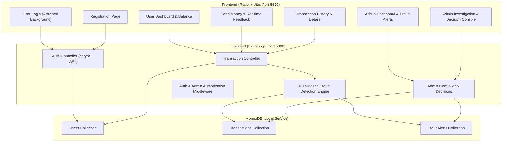

# SecurePay Autonomous Implementation Plan

SecurePay is a complete, full-stack fintech web application featuring a Node.js/Express backend, MongoDB persistence, a modern React frontend, and a transparent, rule-based behavioral fraud detection engine (no machine learning, no device fingerprinting).

## System Architecture

---

## Phases of Implementation

1. **Phase 1: Project Structure and Backend Foundation**
   - Initialize project root at `scratch/securepay`.
   - Setup Git repository with `.gitignore` (`node_modules/`, `.env`).
   - Create Node.js project for backend with `express`, `mongoose`, `cors`, `dotenv`, `bcryptjs`, `jsonwebtoken`.
   - Establish MongoDB connection config in `backend/config/db.js`.

2. **Phase 2: User Registration**
   - Define Mongoose `User` schema (`name`, `email`, `password`, `role`, `balance`, `accountNumber`, `createdAt`).
   - Implement `/api/auth/register` with validation, bcrypt password hashing, and unique email verification.

3. **Phase 3: User Login and JWT Authentication**
   - Implement `/api/auth/login` returning JWT token and safe user payload.
   - Implement `authMiddleware.js` and `adminMiddleware.js`.
   - Implement `/api/auth/me` to fetch current profile and updated balance.

4. **Phase 4: User Login Frontend with Attached Login Image**
   - Copy exact attached image `Right-Payment-Gateway.webp` to `frontend/assets/login-background.webp` and public assets.
   - Build high-contrast, professional glassmorphism login card.
   - Ensure accessibility at `http://127.0.0.1:5500/index.html`.

5. **Phase 5: User Dashboard**
   - React user dashboard showing live balance, account number, quick stats, quick send card, and recent transactions.

6. **Phase 6: Transaction Management**
   - Define Mongoose `Transaction` schema.
   - Implement `/api/transactions/send` with balance check, receiver verification, atomic/sequential balance updates.

7. **Phase 7: Transaction History**
   - Implement `/api/transactions/my-transactions` with filtering, pagination, and detailed rule breakdown.

8. **Phase 8: Behavioural Analysis**
   - Compute historical transaction average, transaction count, typical transfer volume for user.

9. **Phase 9: Rule-Based Fraud Detection Engine**
   - Located in `backend/services/fraudDetection.js`.
   - Calculate `amountScore` (absolute magnitude + ratio to historical mean).
   - Calculate `frequencyScore` (velocity in last 2 mins, 10 mins, rapid bursts).
   - Calculate `timingScore` (unusual night hours 1:00 AM - 5:00 AM).

10. **Phase 10: Risk Scoring & Decision Logic**
    - Calculate composite `riskScore` (0-100) and `riskLevel` (`LOW`: 0-39, `MEDIUM`: 40-69, `HIGH`: 70-100).
    - Assign status:
      - `LOW` -> `COMPLETED`
      - `MEDIUM` -> `MONITORED`
      - `HIGH` -> `UNDER_REVIEW`

11. **Phase 11: Fraud Alerts**
    - Define Mongoose `FraudAlert` schema.
    - Automatically create fraud alert when `riskLevel === 'HIGH'`.

12. **Phase 12: Admin Authentication**
    - Seed default admin account (`admin@securepay.com` / `Admin@123`).
    - Protect all admin routes with `requireAdmin` middleware.

13. **Phase 13: Admin Dashboard**
    - Implement `/api/admin/metrics`, `/api/admin/transactions`, `/api/admin/alerts`.
    - Build admin dashboard UI with transaction volume, risk distribution, alert counts.

14. **Phase 14: Admin Investigation & Transaction Decisions**
    - Implement `/api/admin/transactions/:id/decision` (`APPROVE`, `FLAG_FRAUD`, `KEEP_UNDER_REVIEW`).
    - Balance settlement/refund based on admin decision.
    - Detailed investigation modal in React showing behavioral indicators and risk score breakdown.

15. **Phase 15: Complete Frontend/Backend Integration**
    - Connect all React views to backend APIs.
    - Role-based routing (User vs Admin).
    - Status badges, toast alerts, error handling.

16. **Phase 16: End-to-End Testing**
    - Execute comprehensive test script covering all 22 required test cases.
    - Verify database persistence and state transitions.

17. **Phase 17: Bug Fixing, UI Polishing & Final Verification**
    - Polish fintech styling.
    - Create comprehensive `README.md`.
    - Commit clean git history.
